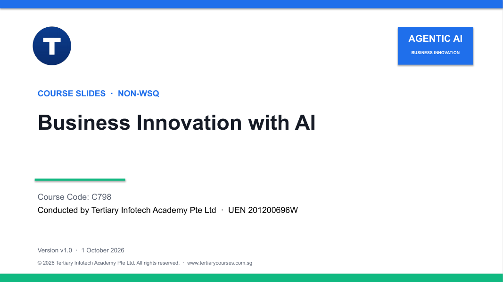

# Business Innovation with AI

A practical one-day course on driving business innovation with generative AI, agentic AI and AI agents — from the 2023–2026 evolution of business AI to a governed implementation roadmap.



| Course detail | Information |
|---|---|
| Course code | `C798` |
| Programme | Non-WSQ |
| Duration | 1 day · 7.5 instructional hours (9:30am – 5:30pm) |
| Registration | [View course details and register](https://www.tertiarycourses.com.sg/business-innovation-with-ai.html) |

## About the course

Participants examine how AI moved from generative AI and prompt engineering to agentic AI, context engineering, harness engineering and AI-powered digital workers, and how that shift changes business models, operating processes and customer experiences.

Through concept visuals, worked business cases and five guided labs, participants work with n8n, Claude Cowork, ChatGPT Work, Claude Code, Codex and Hermes Agent. They identify AI opportunities, weigh value, feasibility, cost and risk, and design an AI-driven innovation initiative with governance, human oversight and continuous improvement.

## Learning outcomes

By the end of the course you will be able to:

1. Compare traditional business models with AI-enabled models and explain the 2023-2026 shift from generative AI to autonomous agents.
2. Identify high-value business opportunities for generative AI, agentic AI and AI agents across functions.
3. Select suitable LLMs and AI technologies and explain reasoning, memory, tools, skills, channels and task execution.
4. Evaluate AI opportunities using value, feasibility, cost, risk, operational impact and human oversight.
5. Design an implementation roadmap using context, harness and loop engineering with governance and continuous improvement.

## Topics covered

1. Evolution of Business AI from Generative AI to Autonomous AI Agents
2. Generative AI, Agentic AI and AI Agent Technologies
3. Context, Harness and Loop Engineering for AI Agents
4. Business Opportunities and Innovative Agentic AI Use Cases
5. Evaluating and Implementing AI-Driven Business Innovation

## Labs

1. [Create a Business Story Video with Gemini](labs/lab-01-gemini-video/README.md)
2. [Build an Agentic Lead-Triage Workflow in n8n](labs/lab-02-n8n-lead-triage/README.md)
3. [Delegate Knowledge Work with Claude Cowork and ChatGPT Work](labs/lab-03-knowledge-work/README.md)
4. [Build an AI Opportunity Scoring App with Claude Code and Codex](labs/lab-04-coding-agents/README.md)
5. [Configure a Governed Digital Worker with Hermes Agent](labs/lab-05-hermes-digital-worker/README.md)

Use non-confidential training data only. Do not grant production credentials or approve external actions during a lab.

## Courseware package (v1.0)

| Item | Files |
|---|---|
| Slide deck (161 slides) | [PPTX](<courseware/Business Innovation with AI-v1.0.pptx>) · [PDF](<courseware/Business Innovation with AI-v1.0.pdf>) |
| Learner Guide | [DOCX](<courseware/LG-Business Innovation with AI-v1.0.docx>) · [PDF](<courseware/LG-Business Innovation with AI-v1.0.pdf>) · [Markdown](<LG-Business Innovation with AI (C798).md>) |
| Lesson Plan | [DOCX](<courseware/LP-Business Innovation with AI-v1.0.docx>) · [PDF](<courseware/LP-Business Innovation with AI-v1.0.pdf>) |
| Labs | [labs/](labs/) — five guided labs |

Product interfaces, access and pricing for the AI tools change often. Verify them before a facilitated activity.

## Repository structure

```text
courseware/        Slide deck, Learner Guide and Lesson Plan (editable + PDF)
labs/              One folder per guided lab
build/             Scripts that rebuild this courseware from its source course
LG-*.md            Markdown mirror of the Learner Guide
```

## Distribution

This repository publishes the learner-facing courseware. Trainer reference material and source files are kept out of the public repository.

---

Provided by [Tertiary Infotech Academy Pte Ltd](https://www.tertiarycourses.com.sg/) · UEN 201200696W
